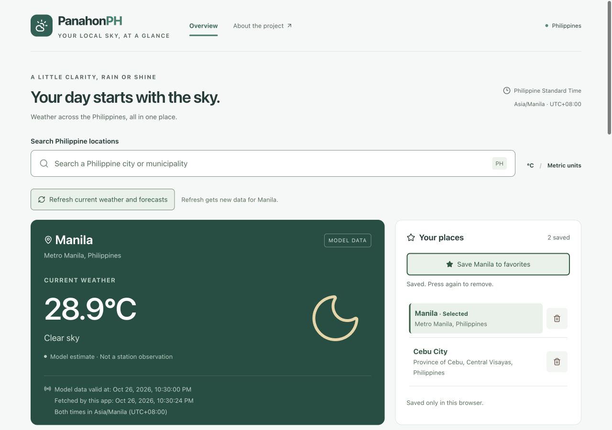

# PanahonPH — Philippine Weather Dashboard

A responsive weather dashboard for Philippine locations, built as a student portfolio project. Search for a place, check its current modeled weather and forecasts, and save locations for your next visit.

**All seven development milestones are complete, including deployment preparation. The site has not been deployed or verified at a public URL.**



*Production-preview screenshot captured October 26, 2026; displayed readings are historical, not current conditions.*

## Features

- Philippine location search with province/region labels, duplicate-name disambiguation, a 300 ms debounce, keyboard navigation, and retry.
- Current temperature, feels-like temperature, relative humidity, wind speed, and understandable conditions with day/night icons. Manila is the initial location.
- The next 24 hourly forecast points, including after midnight: aligned temperature and precipitation-probability charts, readable tooltips, and a complete text/table alternative.
- Seven daily forecasts starting today, with condition, high/low temperature, and maximum hourly precipitation probability.
- Saved places in this browser, safe storage recovery, independent current/forecast refresh, and a small in-memory weather cache.
- Asia/Manila formatting, hour/date rollover, clear timestamps/attribution, missing-value handling, and cancellation safeguards against outdated responses.
- Responsive layouts, semantic landmarks, skip link, visible keyboard focus, touch-friendly controls, concise announcements, and reduced-motion support.

This is an independent portfolio project, not affiliated with PAGASA and not an official warning service.

## Technology

React 19, TypeScript 6, Vite 8, Tailwind CSS 4 with custom CSS, Recharts, and Lucide icons. Tests use Vitest, Testing Library, jsdom, and development-only axe-core. Oxlint and TypeScript provide static checks. Exact dependency versions are locked in `package-lock.json`.

The app is a static browser client: no backend, account system, or database. It calls Open-Meteo directly over HTTPS.

## Local setup

Use **Node.js 24 LTS** with npm. `.nvmrc` selects major version 24, and `package.json` requires `24.x`, matching the prepared Vercel build runtime. Clean-install verification used Node **24.22.1** and npm **11.12.1**.

```sh
git clone https://github.com/ragna0112/PanahonPH.git
cd PanahonPH
# If you use nvm: nvm install && nvm use
npm ci
npm run dev
```

Open the URL printed by Vite, normally `http://localhost:5173`. **No API key or environment variables are required by the current free-API integration.** Do not add credentials to client-side code or commit `.env` files.

| Command | Purpose |
| --- | --- |
| `npm ci` | Install the exact lockfile dependencies, including build/test tools |
| `npm run dev` | Start the development server |
| `npm run lint` | Run Oxlint |
| `npm run typecheck` | Check TypeScript app and build configuration |
| `npm run build` | Type-check and generate static files in `dist/` |
| `npm run check` | Run lint, typecheck, and production build |
| `npm test` | Run the complete Vitest suite once |
| `npm run preview` | Serve an existing production build locally |

To check the production output rather than the development server:

```sh
npm run build
npm run preview -- --host 127.0.0.1 --port 4173 --strictPort
```

Open `http://127.0.0.1:4173`. Internet access is still needed for live search/weather. Vite preview is a local verification server, not a production hosting server. [Vite's static deployment guide](https://vite.dev/guide/static-deploy) explains the build/preview distinction.

## How a search becomes weather

1. `LocationSearch` waits until a query has at least three characters and the user pauses for about 300 ms.
2. The geocoding service sends the name to Open-Meteo with `countryCode=PH`. It validates returned Philippine country codes, stable GeoNames IDs, labels, feature types, and coordinates. Province/region and coordinates distinguish identical names.
3. Selecting a result passes its **returned latitude and longitude**, not its name, to two independent weather requests: current conditions and hourly/daily forecasts.
4. Typed services validate HTTP responses, units, ranges, timestamps, and forecast array lengths. React turns the validated values into readings, charts, and daily cards. Missing values stay unavailable; chart gaps are not filled with invented readings.

Changing locations cancels pending work and removes the old place's readings before the new place can display them. Request identity checks also reject late responses. A failed forecast request does not discard successful current weather; each resource has its own retry.

`src/services/` contains API validation, weather-code mapping, favorite serialization, and cache logic. `src/hooks/` coordinates requests, favorites, and rollover; `src/components/` renders search, saved places, and forecasts. `src/App.tsx` composes the dashboard. Test fixtures are isolated in test files and `src/test/`, outside the production import graph.

## Time, units, saved places, and refresh

All displayed dates/times use **Asia/Manila (UTC+08:00)** through `Intl.DateTimeFormat`, independently of the browser timezone. Unix timestamps are converted once to milliseconds; an extra UTC+8 offset is not added to returned instants.

- **Model data valid at** is the API's current-weather timestamp: when the modeled conditions apply, not a station observation.
- **Fetched by this app** and **Forecast fetched by this app** are device-clock receipt times after a successful response. They are not model-run times. Cached readings retain these original timestamps.
- Chart times are forecast-valid times, and daily cards represent Manila calendar days.
- Temperature is °C, wind speed is km/h, and precipitation probability is %. Hourly probability concerns more than 0.1 mm during the preceding hour ending at the labeled time; it is not rainfall amount. Daily maximum probability is the maximum hourly probability, not the probability of any rain over the whole day.

**Favorites:** localStorage key `panahonph.favorites` stores a validated version-1 list of location IDs, labels, coordinates, and country tags. Favorites persist only in this browser and origin; they do not sync across devices, localhost ports, or a future public domain. Weather readings are not stored there. Duplicate IDs are prevented, and removing an active favorite leaves that place displayed. Corrupt/unavailable/full storage produces a warning while session favorites remain usable.

**Weather cache:** up to eight locations in memory, with least-recently-used eviction and a five-minute freshness period for switching locations. Keys include ID and exact coordinates; current weather and forecasts are cached independently. A fresh resource is reused; an absent/expired resource is requested. Reload clears the cache and starts at Manila.

**Refresh:** manual refresh bypasses cache freshness for both resources. Repeated clicks cannot create duplicate in-flight requests. Same-location readings remain visible while updating. Success advances only that resource's fetch timestamp; failure labels retained readings as an earlier fetch and offers retry.

**Rollover:** an hour-boundary timer and tab-visibility/window-focus checks reselect the next 24 hours and today's seven days. The API requests eight days so retained arrays can cover a subsequent midnight. Covered windows need no new request. Insufficient coverage causes one forecast request; failure requires manual retry, rather than aggressive polling. Current conditions are not automatically refreshed each hour. The device clock affects fetch labels and window selection.

## Data sources, attribution, and portfolio usage

Weather and location search use [Open-Meteo's forecast API](https://open-meteo.com/en/docs) and [geocoding API](https://open-meteo.com/en/docs/geocoding-api); location data originates from [GeoNames](https://www.geonames.org/). API data are licensed under [CC BY 4.0](https://creativecommons.org/licenses/by/4.0/). The dashboard visibly credits Open-Meteo/GeoNames, links the licence, and identifies display changes (rounded values and weather descriptions/icons), without claiming provider endorsement. Retain these notices when publishing. See the [provider's licence conditions](https://open-meteo.com/en/licence).

The [terms](https://open-meteo.com/en/terms) and [pricing limits](https://open-meteo.com/en/pricing) were rechecked on **October 26, 2026**. The free API is noncommercial only. Terms require fewer than 10,000 calls/day, 5,000/hour, and 600/minute; pricing also lists a 300,000-call monthly cap. Limits apply by IP/application, and access may be blocked for misuse. There is no free-tier availability guarantee.

Personal educational sites without advertising/subscriptions are among the noncommercial examples. **Commercial products and promotional activities are commercial under the terms. A public portfolio is not automatically exempt:** if the site promotes paid services or a business, or the classification is unclear, obtain provider clarification or arrange appropriate commercial access before publishing. CC BY permission to reuse data does not remove the free API's access restrictions. The present client uses free endpoints without a key; commercial access would require revisiting the integration, not adding a secret to a public `VITE_*` variable.

## Testing and verification

```sh
npm run check
npm test
TZ=America/New_York npm test
```

The timezone command uses POSIX-shell syntax (macOS/Linux or a suitable shell on Windows). The suite also explicitly tests formatting with a non-Manila default timezone. It covers API validation/errors/cancellation, weather codes, PH filtering, duplicate locations, debounce/keyboard selection, late responses, independent failures/retry, missing-value gaps, forecast units/windows, storage recovery, cache expiry, refresh deduplication, and controlled-clock rollover/tab return.

**Milestone 7:** a fresh temporary source copy, without shared `node_modules`, passed `npm ci`, `npm run check`, and all **179 tests** in both timezone runs on Node 24.22.1. Its production build was served locally for live-browser verification. See the [verification record](docs/VERIFICATION.md) for results, earlier accessibility checks, and remaining test limits. Production entry/bundle and tracked-file audits found no test mocks, local filesystem paths, credentials, tracked dependencies, or tracked build output. No dependency versions were upgraded for milestone 7.

## Known limitations

- Weather is model-based and may represent a nearby grid cell; it is not a local station observation or an official PAGASA alert. Consult official advisories for safety decisions.
- API availability, rate limits, network access, provider coverage, and device-clock accuracy affect results. Missing measurements display as unavailable, and expired forecast coverage is not fabricated.
- Search depends on GeoNames naming/ranking and includes populated places that may be smaller than legally designated municipalities. Favorites do not provide offline weather or cross-device sync.
- Browser checks are viewport simulations, not physical-device tests. Screen-reader testing and native 200% browser-zoom testing remain outstanding. Earlier 200% text-size checks and automated/manual accessibility checks do **not** establish full WCAG compliance. Pointer chart tooltips are supplemented by the keyboard-accessible table.
- No public deployment, Vercel cloud build, custom domain, or production-origin API access has been verified yet.

## Deploy to Vercel when ready

Deployment preparation is complete; **deployment itself has not been performed**. Current official [Vercel Vite documentation](https://vercel.com/docs/frameworks/frontend/vite), [build settings](https://vercel.com/docs/builds/configure-a-build), and [Node support](https://vercel.com/docs/functions/runtimes/node-js/node-js-versions) were reviewed on October 26, 2026.

| Setting | Value |
| --- | --- |
| Repository / production branch | `ragna0112/PanahonPH` / `main` |
| Root directory | Repository root (`.`) |
| Framework preset | **Vite** |
| Node.js | **24.x** (also set by `package.json`) |
| Install command | **`npm ci`**; include devDependencies for the build tools |
| Build command | **`npm run build`** |
| Output directory | **`dist`** |
| Required environment variables / API keys | **None** for the current integration |

Vercel can detect Vite and serve its static output. No `vercel.json`, server/plugin, custom base path, or routing rewrite is needed: this dashboard uses `/` and in-page anchors, not client-side URL routes. Keep Vite's root base path for Vercel. Do not upload the repository or `node_modules` as static output.

When you choose to deploy:

1. Resolve the Open-Meteo portfolio-use/licensing point above for the intended public use.
2. In Vercel, choose **Add New → Project**, import this GitHub repository, and select `main` as the production branch. Verify every setting in the table, especially `npm ci`, Node 24.x, and `dist`.
3. Choose **Deploy** and inspect the cloud install/build logs. This is a future action; it was not run during milestone 7.
4. At the resulting HTTPS URL, repeat the smoke test: Manila weather, Cebu City search/selection, save both places, reload, switch, refresh, hourly charts/table, and seven daily cards. Check console/network failures, mobile layout, timestamps, and attribution.
5. Confirm favorites are stored separately for that new origin. Add a live-demo link to this README only after the public deployment and smoke test succeed.

## Milestone checklist

- [x] 1 — Project foundation and responsive dashboard shell
- [x] 2 — Live current weather for Manila
- [x] 3 — Philippine city and municipality search
- [x] 4 — Hourly charts and seven-day forecasts
- [x] 5 — Saved locations, cache, refresh, and forecast rollover
- [x] 6 — Interface polish and accessibility
- [x] 7 — Final verification, portfolio documentation, and deployment preparation

**Actual deployment: not performed.** No live-demo URL is claimed.
